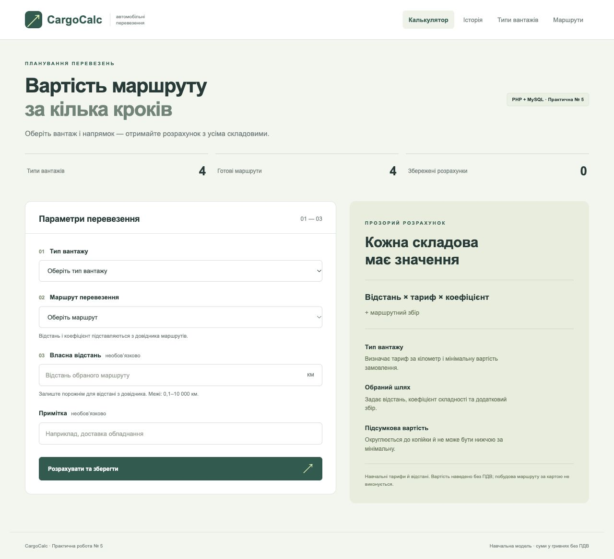

# CargoCalc — калькулятор автомобільного перевезення

Практична робота № 5
Варіант: **автоматичний розрахунок вартості автомобільного перевезення на основі типу вантажу, відстані та маршруту**.

Серверний застосунок на PHP 8.3, MySQL 8.4 та Apache.



## Запуск через Docker

Потрібні Docker Desktop з увімкненим рушієм та Docker Compose v2. У терміналі відкрийте папку проєкту й виконати:

```bash
docker compose up -d --build --wait
```

Відкрити [http://localhost:8086](http://localhost:8086). Під час першого запуску створюється база з чотирма типами вантажів і чотирма маршрутами. Історія спочатку порожня. Початковий SQL виконується лише для нового тому БД.

Щоб змінити порт чи демонстраційні паролі, скопіювати `.env.example` у `.env`, змінити значення та запустити Compose. Зміна пароля в `.env` не змінює пароль користувача у вже створеному томі MySQL.

```bash
docker compose ps
docker compose logs --tail=50
docker compose down
```
